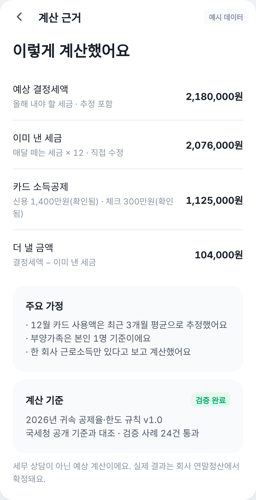
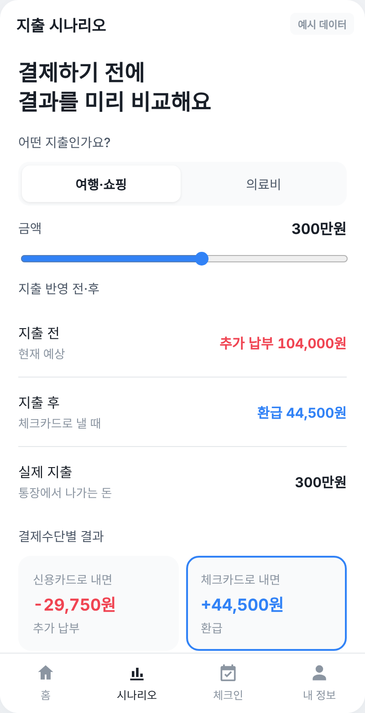
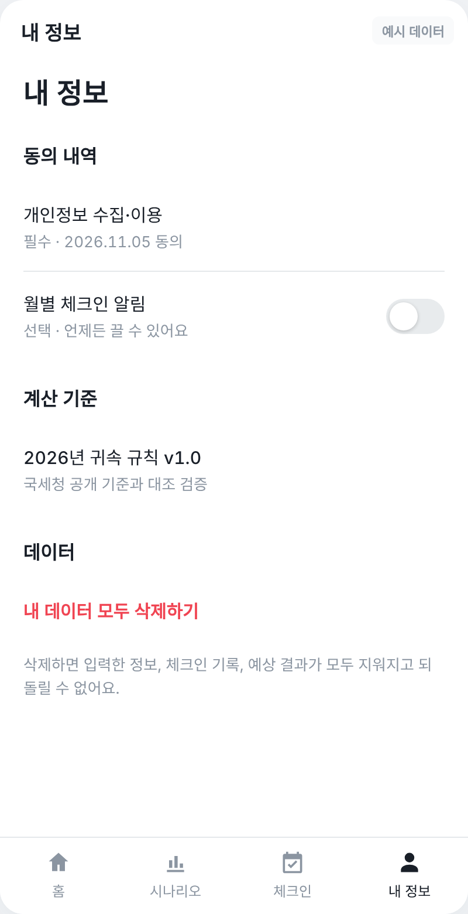
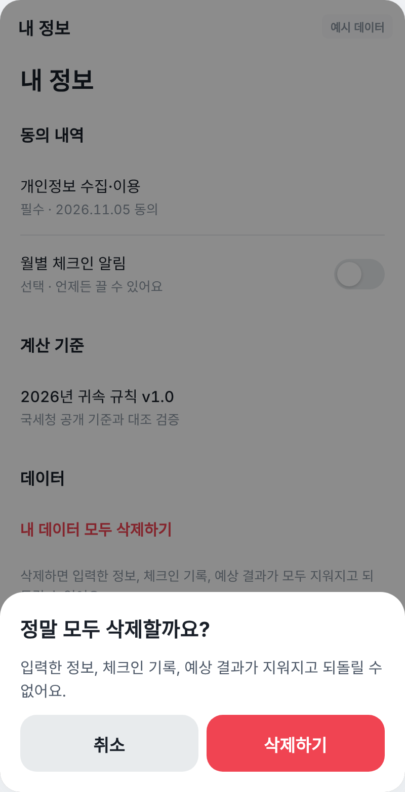

# MVP 프로토타입 | 연말정산 미리 준비

- **작성일:** 2026-11-05
- **범위:** MoSCoW Must 8개
- **디자인:** 토스 디자인 시스템(TDS) 스타일 참고
- **실행:** [`mvp-prototype.html`](mvp-prototype.html)을 브라우저로 열기. 모든 숫자는 예시 데이터

## Must 8개와 화면

| Must | 화면 |
|---|---|
| 정보 자동 채움 + 일괄 확인·수정 |  |
| 예상 환급·추가 납부 계산 (정보 부족 시 보류) |   |
| 데이터 출처·추정 상태 표시 |   |
| 월별 체크인 + 현재 결과 갱신 |   |
| 추가 납부 경보 + 기본 대비 안내 |  |
| 단일 지출 시뮬레이션 |  |
| 개인정보 동의·삭제·계산 검증 |    |
| 핵심 이용 지표 수집 | HTML 오른쪽 개발용 패널 (첫 결과 확인, 체크인 완료, 시뮬레이션 이용 등) |

## 시연 순서

1. 동의 → 정보 확인 → 홈: '매달 떼는 세금'이 비어 있어 금액 계산 보류
2. 정보 확인에서 매달 떼는 세금 입력(예: 173000) → 홈에 예상 금액 표시
3. 지출 시나리오 → 월별 체크인("이번 달도 같아요") → 추가 납부 경보 → 내 정보에서 삭제
