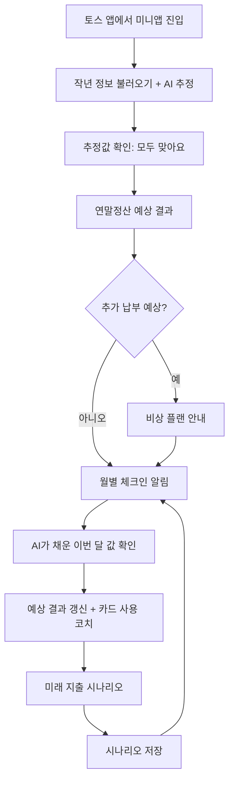
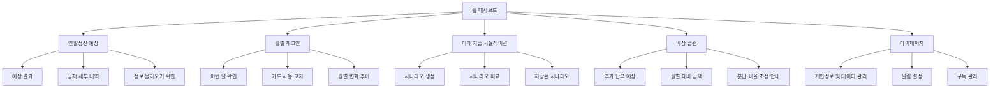

# PRD v2 | AI 기반 연말정산 사전 관리 플랫폼

**문서 버전:** v2 (기존 PRD v1 개정안)  
**작성일:** 2026.11.05  
**서비스 유형:** 개인 맞춤형 연말정산 예측·관리 서비스  
**서비스 대상:** 대한민국 근로소득자  
**출시 채널:** 1차 앱인토스(토스 앱 안의 미니앱) → 검증 후 단독 앱  
**핵심 기능:** 연말정산 예상 시뮬레이션 / 월별 절세 체크인(+카드 사용 코치) / 미래 지출 시나리오 / 추가 납부 비상 플랜  
**서비스 방향:** 연말정산의 사후 확인을 사전 예측 및 지속적 관리 경험으로 전환하되, **사용자 입력은 최소화하고 AI와 기존 정보로 최대한 자동화한다.**

---

## v2 주요 변경 사항

| # | 변경 내용 | 반영 위치 |
|---|---|---|
| 1 | **입력 최소화·자동화 원칙 추가** — AI와 기존 정보(전년 연말정산 자료, 급여명세서 등)로 값을 미리 채우고, 사용자는 '확인' 클릭만 하는 구조 | 01, 03, 04, 05 |
| 2 | **사용자 시나리오는 추후 재작성** — 앞으로 전달받는 정보를 바탕으로 다시 작성 (v1 예시는 참고용으로만 유지) | 03, 06 |
| 3 | **추가 납부 비상 플랜 신설** — 환급이 아니라 세금을 더 내야 하는 상황에 대비하는 기능 | 07 (신규) |
| 4 | **수익 모델 변경** — 기본 월별 변화 확인을 무료에서 제외(프리미엄 전용) | 11 |
| 5 | 카드 사용 코치, 삼쩜삼 대비 차별점, 앱인토스 우선 출시 전략 반영 | 01, 05, 12 |

---

# 01. 제품 개요 (Product Overview)

## 1.1 서비스 콘셉트

> **"연말정산 결과를 기다리지 않고, 클릭 몇 번으로 매월 확인하고 미리 대비하는 개인 맞춤형 절세 관리 서비스."**

기존 연말정산 서비스는 사용자가 연말 또는 연초에 세금 환급 여부를 확인하고 신고하는 데 집중되어 있다.

본 서비스는 사용자의 소득과 소비 데이터를 기반으로 연말정산 예상 결과를 제공하고, 남은 기간의 지출 계획에 따른 변화를 예측한다. 이때 **필요한 정보는 AI와 기존 자료로 먼저 채워두고, 사용자는 확인만 하도록** 설계해 입력 부담을 없앤다.

### 핵심 가치 제안

| 핵심 가치 | 기존 문제 | 해결 방향 |
|---|---|---|
| 예측 가능성 | 연말까지 예상 결과를 알기 어려움 | 현재 데이터 기반 예상 환급·추가 납부액 제공 |
| **입력 없는 관리** | 매달 숫자를 입력하는 게 귀찮아 중도 이탈 | AI 자동 채움 + '맞아요' 클릭으로 체크인 완료 |
| 지속적 관리 | 특정 시기에만 연말정산을 확인 | 월별 소비 및 공제 현황 체크인 |
| 계획 수립 | 미래 소비가 연말정산에 미치는 영향 파악 어려움 | 예정 지출에 따른 결과 비교 |
| **위기 대비** | 추가 납부를 연초에 갑자기 알게 됨 | 조기 경보 + 비상 플랜 제공 |

### 경쟁 서비스 대비 포지셔닝

> 삼쩜삼이 **"이미 낸 세금을 돌려받는 앱"**이라면, 우리는 **"1월부터 계획해서 덜 내고 더 받는 앱"**이다.

| 구분 | 기존 서비스(삼쩜삼·홈택스 미리보기 등) | 본 서비스 |
|---|---|---|
| 이용 방식 | 사용자가 계산기를 찾아 들어가서 1회 계산 | 매달 먼저 알려주는 코치 |
| 계산 기준 | 이미 쓴 소비(과거) | 앞으로 쓸 돈(미래)까지 반영 |
| 입력 | 항목별 직접 입력 | AI가 미리 채움, 사용자는 확인 클릭 |
| 수익 구조 | 환급 수수료 | 구독·광고 (환급금에서 떼어가지 않음) |

## 1.2 제품 목표

### 비즈니스 목표

1. 연말정산 서비스의 계절적 사용 패턴을 연중 이용 구조로 전환한다.
2. **입력 부담을 없애** 사용자가 매달 부담 없이 돌아오게 한다.
3. 기본 예측은 무료로 제공하고, **월별 변화 확인·코칭·시나리오·리포트를 유료화**한다.

### 사용자 목표

1. 클릭 몇 번으로 현재 기준 연말정산 결과를 예측할 수 있다.
2. 매월 자신의 소비와 공제 현황을 거의 입력 없이 확인할 수 있다.
3. 앞으로의 지출 계획이 예상 결과에 미치는 영향을 비교할 수 있다.
4. 추가 납부가 예상되면 미리 알고 대비할 수 있다.

## 1.3 핵심 타깃

**Primary Target: 25~39세 근로소득자**

- 연말정산 경험이 적은 사회초년생 (메인 페르소나 후보)
- 연말정산 결과를 미리 예측하고 싶은 직장인
- 소비 계획을 세우지만 세금과의 관계를 파악하기 어려운 사용자
- 숫자 입력·서류 정리를 귀찮아하는 사용자

**Secondary Target: 40~50대 근로소득자**

- 의료비·교육비 등 다양한 공제 항목을 관리해야 하는 사용자
- 가족 구성 및 공제 조건 변화가 있는 사용자

---

# 02. 문제 정의 (Problem Statement)

## 2.1 사용자 문제

### 문제 1. 연말정산 결과를 너무 늦게 확인한다.

- 추가 납부가 발생할 경우 사전에 대비하기 어렵다.
- 연중 소비에 따른 세금 영향을 확인하기 어렵다.
- 과거 데이터를 확인하더라도 앞으로 어떻게 달라지는지 예측하기 어렵다.

**해결 방향:** 현재까지의 소득과 공제 데이터를 기반으로 연말정산 예상 결과를 지속적으로 갱신한다.

### 문제 2. 공제 현황을 지속적으로 관리하기 어렵다.

- 공제 대상 지출과 일반 소비를 구분하기 어렵다.
- 자신이 현재 어느 정도의 공제 요건을 충족했는지 파악하기 어렵다.
- 월별 소비 변화가 연말정산 결과에 어떻게 반영되는지 알기 어렵다.

**해결 방향:** 월별 데이터를 시각화하고, 핵심 공제 항목의 충족 여부와 예상 결과 변화를 정기적으로 제공한다.

### 문제 3. 미래 소비 계획을 세금과 연결하기 어렵다.

- 결제수단별 공제 반영 차이를 알기 어렵다.
- 지출 계획을 변경했을 때 결과를 비교하기 어렵다.
- 세금 혜택을 과대평가하거나 소비 자체가 절세라고 오해할 가능성이 있다.

**해결 방향:** 예정 지출과 결제수단을 입력하면 실제 공제 적용 조건을 고려하여 예상 결과를 비교한다.

### 문제 4. (신규) 입력이 귀찮아서 관리를 포기한다.

- 매달 급여·카드 사용액·공제 항목을 직접 입력해야 하면 2~3개월 안에 이탈한다.
- 이미 국세청·회사·카드사에 있는 정보를 사용자가 다시 옮겨 적어야 한다.

**해결 방향:** AI와 기존 정보로 값을 미리 채우고, 사용자는 맞는지만 확인한다. **"클릭, 클릭, 끝."**

### 문제 5. (신규) 추가 납부가 나오면 대비할 방법이 없다.

- 연초에 갑자기 수십만 원의 추가 납부 통보를 받으면 생활비가 부족해진다.
- 분납 등 공식적으로 부담을 나눌 방법이 있어도 잘 모른다.

**해결 방향:** 추가 납부가 예상되는 순간부터 조기 경보와 월별 대비 플랜을 제공한다.

---

# 03. 핵심 사용자 경험 (Core User Experience)

## 3.1 UX 핵심 원칙: 입력 최소화 · 자동화

> **사용자는 '입력'하지 않고 '확인'한다.**

| 원칙 | 설명 |
|---|---|
| 먼저 채워둔다 | 모든 입력 화면은 빈칸이 아니라, AI·기존 정보로 채운 값을 보여주며 시작한다 |
| 확인은 한 번에 | 여러 항목을 한 화면에 묶어 '모두 맞아요' 한 번으로 확정한다 |
| 고칠 것만 고친다 | 틀린 항목만 눌러서 수정한다. 나머지는 그대로 둔다 |
| 출처를 보여준다 | 각 값 옆에 '작년 자료', 'AI 추정', '명세서 인식' 같은 출처 라벨을 표시한다 |
| 추정은 추정이라고 말한다 | AI 추정값은 확정값처럼 보이지 않게 표시하고 결과 신뢰도(FR-04)에 반영한다 |

### 클릭 목표

| 상황 | 목표 클릭 수 | 흐름 |
|---|---|---|
| 첫 가입 ~ 첫 예상 결과 | **3회 이내** | 토스 로그인 동의 → 작년 정보 불러오기 → AI 추정값 '모두 맞아요' |
| 매월 체크인 | **1~2회** | 알림 탭 → AI가 채운 이번 달 값 '맞아요' |
| 미래 지출 시나리오 | **3회 이내** | 지출 유형 선택 → 금액 선택(추천 금액 칩) → 결과 보기 |

## 3.2 자동화 데이터 소스

각 정보는 아래 순서로 채운다. 위 단계에서 얻을 수 없으면 다음 단계로 내려간다.

| 데이터 | ① 기존 정보 불러오기 | ② AI 추정 | ③ 최후 수단 |
|---|---|---|---|
| 총급여 | 전년 연말정산 자료(간편인증), 급여명세서 사진 인식 | 연봉 한 번 입력 시 월급여 자동 계산 | 직접 입력 |
| 원천징수세액 | 급여명세서 사진 인식 | 총급여·부양가족 기준 간이세액표로 추정 | 직접 입력 |
| 카드·현금영수증 사용액 | 카드 명세서·결제 알림 캡처 인식 / (확장) 마이데이터 연동 | 전년 소비 패턴 기반 월 사용액 추정 | 직접 입력 |
| 부양가족 | 전년 연말정산 자료 | 변경 여부만 질문 ("작년이랑 같아요?") | 선택 입력 |
| 보험료·의료비·교육비 | 전년 연말정산 자료 | 전년 대비 비슷한 수준으로 추정 + '올해는 없어요' 원클릭 | 항목별 입력 |
| 연금계좌 납입액 | 전년 자료 | 월 납입액 × 개월 수로 추정 | 직접 입력 |

**용어**
- **간편인증:** 카카오·네이버·토스 인증서로 본인 확인하는 방식
- **사진 인식(OCR):** 사진 속 글자를 AI가 읽어 숫자로 바꾸는 기술
- **마이데이터:** 사용자 동의 하에 금융사 데이터를 받아오는 제도 (사업자 허가 필요)

### 구현 단계

| 단계 | 자동화 범위 |
|---|---|
| 프로토타입 | 더미 데이터(진짜처럼 보이는 예시 데이터)로 '불러오기 성공 → 확인 클릭' 흐름 시연, 화면에 '예시 데이터' 표시 |
| MVP | AI 추정 + 사진 인식 + 전년 정보 재사용. 전년 자료 불러오기는 제휴·법률 검토 결과에 따라 적용 |
| 확장 | 마이데이터 등 금융기관 자동 연동 |

## 3.3 전체 서비스 플로우

## 3.4 사용자 시나리오

> **작성 예정** — 추후 전달받는 정보(사용자 조사, 페르소나 등)를 바탕으로 다시 작성한다.  
> v1의 시나리오(6.2)는 기능 설명용 예시로만 유지하며, 확정된 사용자 시나리오가 아니다.

---

# 04. 핵심 기능 1 — 연말정산 예상 시뮬레이션

## 4.1 기능 정의

사용자의 현재 소득, 기납부세액, 공제 관련 정보를 기반으로 해당 과세연도의 연말정산 예상 환급액 또는 추가 납부액을 산출하는 기능.

> "지금까지의 소득과 소비를 기준으로, 올해 연말정산 결과는 어떻게 예상될까?"

## 4.2 사용자 입력 데이터 (v2 변경)

v1의 '직접 입력 기본' 방식을 **'자동 채움 + 확인' 기본** 방식으로 바꾼다. 데이터별 채움 순서는 3.2를 따른다.

| 데이터 유형 | 세부 항목 | 입력 방식 (v2) |
|---|---|---|
| 기본 정보 | 과세연도, 근로 기간 | 자동 설정, 변경 시 선택 |
| 소득 정보 | 총급여 또는 예상 연간 총급여 | 불러오기 / AI 추정 → 확인 |
| 납부세액 | 현재까지 원천징수된 소득세 등 | 명세서 인식 / AI 추정 → 확인 |
| 카드 지출 | 신용카드·체크카드·현금영수증 사용액 | 캡처 인식 / AI 추정 → 확인 |
| 공제 관련 정보 | 보험료, 의료비, 교육비, 연금계좌 납입액 등 | 전년 자료 / AI 추정 → 확인 |
| 인적공제 정보 | 부양가족 및 공제 요건 관련 정보 | 전년 자료 → "작년이랑 같아요?" |

## 4.3 주요 기능 요구사항

### FR-01. 기본 정보 수집 (v2 변경)

- 시스템은 첫 진입 시 가능한 데이터 소스에서 값을 **먼저 채워** 보여줘야 한다.
- 사용자는 채워진 값 전체를 **한 번의 클릭으로 확정**할 수 있어야 한다.
- 사용자는 틀린 항목만 골라 수정할 수 있어야 한다.
- 각 값에는 출처 라벨(작년 자료 / AI 추정 / 명세서 인식 / 직접 입력)이 표시되어야 한다.
- 자동으로 채울 수 없는 필수 항목만 사용자에게 질문한다.

### FR-01A. (신규) AI 자동 채움

- 연봉 한 가지만 알아도 월급여·원천징수세액·카드 사용액을 추정할 수 있어야 한다.
- 급여명세서·카드 명세서 사진을 올리면 필요한 숫자를 인식해 채워야 한다.
- 인식 결과가 불확실한 값은 확정하지 않고 사용자 확인을 요청해야 한다.
- 추정 근거를 한 줄로 설명할 수 있어야 한다. (예: "작년 같은 달 사용액 기준")

### FR-02. 예상 결과 계산

시스템은 해당 과세연도에 적용되는 세법과 공제 요건을 기반으로 예상 결과를 산출한다.

1. 예상 연간 총급여 산출
2. 적용 가능한 소득공제 추정
3. 과세표준 추정
4. 산출세액 계산
5. 적용 가능한 세액공제·감면 반영
6. 예상 결정세액 계산
7. 예상 연간 기납부세액과 비교
8. 예상 환급액 또는 추가 납부액 표시

### FR-03. 결과 시각화

- 예상 환급액 또는 추가 납부액
- 반영된 주요 공제 항목
- 아직 확인하지 않은 항목
- 계산 기준 과세연도 및 업데이트 날짜

*'지난 계산 대비 예상 결과 변화'는 v2부터 프리미엄 기능(11장)으로 이동한다.*

### FR-04. 예상 결과 신뢰도 표시 (v2 보완)

- **입력 부족:** 핵심 소득 또는 세액 데이터 누락
- **AI 추정 포함:** 일부 값이 AI 추정값이며 사용자가 아직 확인하지 않음
- **확인 완료:** 계산에 필요한 항목을 사용자가 모두 확인함

확인 완료 상태여도 실제 환급액의 정확성을 보장하지 않으며, 공식 서류 확인 여부를 별도로 표시한다.

## 4.4 화면 구성

**Screen 00 — (신규) 정보 불러오기·확인**
- 불러오는 중 로딩 ("작년 정보를 불러오는 중이에요")
- 채워진 값 목록 + 출처 라벨
- CTA: '모두 맞아요' / 틀린 항목만 탭해서 수정

**Screen 01 — 연말정산 대시보드**
- 상단: 예상 환급·추가 납부액
- 중단: 연간 소득 및 주요 공제 현황
- 하단: 월별 예상 결과 추이 (프리미엄, 무료는 잠금 표시)
- CTA: '지출 시뮬레이션'

**Screen 02 — 세부 계산 결과**
- 소득공제·세액공제 요약, 예상 결정세액, 예상 기납부세액, 계산 기준 및 추정 안내

## 4.5 완료 조건 (Acceptance Criteria)

- 첫 진입부터 예상 결과까지 **3회 이내 클릭**으로 도달한다. (자동 채움이 가능한 경우)
- 자동으로 채운 값과 직접 입력한 값이 출처 라벨로 구별된다.
- 입력값 수정 후 계산 결과가 갱신된다.
- 환급과 추가 납부가 시각적으로 구별된다.
- 계산할 수 없는 상태에서 근거 없는 예상 금액을 출력하지 않는다.

---

# 05. 핵심 기능 2 — 월별 절세 체크인 (+카드 사용 코치)

## 5.1 기능 정의

사용자가 매월 자신의 소득과 소비 및 공제 현황을 확인하고, 예상 연말정산 결과가 어떻게 바뀌었는지 보는 기능. **v2에서는 AI가 이번 달 값을 미리 채워두고, 사용자는 확인만 한다.**

## 5.2 주요 기능 요구사항

### FR-05. 월별 데이터 확인 (v2 변경)

| 데이터 | 채우는 방식 |
|---|---|
| 월별 소득 | 지난달과 같다고 가정해 자동 채움, 상여 등 변동만 수정 |
| 신용·체크카드·현금영수증 | 캡처 인식 / 소비 패턴 기반 AI 추정 |
| 주요 공제 항목 | 정기 납입(연금 등)은 자동 반영, 비정기 항목만 질문 |
| 데이터 상태 | AI 추정 / 확인 완료 / 수정 필요 |

- 사용자는 '이번 달 맞아요' 한 번으로 체크인을 완료할 수 있어야 한다.

### FR-06. 공제 항목별 진행 현황

- 현재까지 누적 사용액, 총급여 기준 공제 적용 요건, 공제 반영 대상 추정 금액, 카드 유형별 사용액을 보여준다.
- 신용카드 소득공제는 적용 요건, 결제수단, 공제 제외 지출, 한도 등에 따라 달라지므로 단순 총사용액만으로 공제액을 확정하지 않는다.

### FR-06A. (신규) 카드 사용 코치 — 프리미엄

카드 소득공제는 총급여의 25%를 넘게 쓴 금액부터 적용되고, 공제율은 신용카드 15%, 체크카드·현금영수증 30%다. 이를 바탕으로 **지금 어떤 카드를 쓰는 게 유리한지** 단계별로 안내한다.

| 단계 | 상황 | 안내 예시 |
|---|---|---|
| 1 | 25% 미만 | "연봉 25%까지 62% 왔어요. 아직은 신용카드를 쓰세요." |
| 2 | 25% 거의 도달 | "곧 기준선을 넘어요! 체크카드로 바꿀 준비를 하세요." |
| 3 | 25% 넘음 | "이제부터는 체크카드가 공제율 2배예요." |
| 4 | 공제 한도 도달 | "올해 카드 공제는 꽉 찼어요. 혜택 좋은 카드를 자유롭게 쓰세요." |

- 신용카드 **전월 실적**(지난달 일정 금액 이상 써야 혜택을 주는 조건)을 함께 고려해 안내할 수 있어야 한다. (예: "전월 실적 30만 원은 채웠으니 나머지는 체크카드로")
- 대중교통·전통시장 등 별도 공제율 항목은 확장 단계에서 반영한다.

### FR-07. 월별 예상 결과 변화 — 프리미엄 (v2 변경)

- 지난달과 이번 달의 예상 연말정산 결과를 비교한다.
- 변화 원인을 소득, 공제 입력값, 추정 가정 변경 기준으로 구분해 제공한다.
- **무료 사용자에게는 제공하지 않으며**, 잠금 화면과 구독 안내를 표시한다.

### FR-08. 월별 체크인 알림

- 매월 지정한 시점에 체크인 알림을 보낸다. (앱인토스 푸시 알림 활용)
- 알림을 누르면 AI가 채운 이번 달 확인 화면으로 바로 이동한다.
- 사용자는 알림을 끄거나 빈도를 변경할 수 있다.

**알림 예시:** "10월 정보를 미리 채워뒀어요. 맞는지 확인만 해주세요."

## 5.3 화면 구성

**Screen 03 — 월별 체크인 대시보드**
- 이번 달 확인 상태, 누적 소비 현황, 공제 진행 현황
- 카드 사용 코치 진행 바 (프리미엄)
- 지난달 대비 변화 (프리미엄)
- CTA: '이번 달 확인하기'

**Screen 04 — 이번 달 확인**
- AI가 채운 값 목록 + 출처 라벨
- CTA: '이번 달 맞아요' / 틀린 항목만 수정

## 5.4 완료 조건

- 알림 진입부터 체크인 완료까지 **1~2회 클릭**으로 끝난다.
- 데이터 변경 후 예상 결과를 다시 계산한다.
- 체크인 미완료와 실제 지출이 없는 상태를 구분한다.
- 무료 사용자는 월별 변화·카드 코치 화면에서 잠금 상태를 본다.

---

# 06. 핵심 기능 3 — 미래 지출 시나리오

## 6.1 기능 정의

사용자가 앞으로 예정된 지출 금액, 시점, 결제수단을 입력하면 현재 예상 결과에 반영해 변화를 비교하는 기능. 사용자의 미래 의사결정을 지원하는 **핵심 차별화 기능**이다.

> "앞으로 예정된 소비를 반영하면, 올해 연말정산 결과는 얼마나 달라질까?"

## 6.2 기능 설명용 예시 (v1 유지, 확정 시나리오 아님)

> 사용자 시나리오는 3.4에 따라 추후 재작성한다.

- **예시 A. 여행 지출:** 12월 여행 100만 원 — 여행비 자체가 공제 대상은 아니며, 카드 소득공제 대상 여부만 반영
- **예시 B. 의료비 지출:** 연말 의료비 계획 — 기존 지출과 합산해 공제 반영 여부 확인
- **예시 C. 결제수단 비교:** 같은 100만 원을 신용카드 vs 체크카드로 결제할 때 비교

## 6.3 주요 기능 요구사항

### FR-09. 미래 지출 등록 (v2 보완)

- 지출 유형은 **칩 선택**(여행, 이사, 병원, 학원 등), 금액은 **추천 금액 칩**으로 고를 수 있어야 한다.
- 결제수단은 AI가 유리한 쪽을 미리 선택해두고 사용자가 바꿀 수 있어야 한다.
- 시나리오 이름은 자동 생성한다. (예: "12월 여행 계획")

### FR-10. 시나리오별 예상 결과 계산

1. 현재 기준 예상 결과 확보
2. 예정 지출 정보 확인
3. 공제 대상 여부 및 조건 판단
4. 공제 계산 규칙 적용
5. 지출 반영 후 예상 결과 계산
6. 기존 결과와 비교

### FR-11. 복수 시나리오 비교

- 서로 다른 지출 계획을 저장·비교할 수 있어야 한다.
- 동일한 예정 지출은 대안 관계로 설정되며 중복 합산되지 않아야 한다.

### FR-12. 시나리오 저장 및 수정

- 저장·수정·삭제할 수 있다.
- 실제 지출이 발생하면 월별 체크인 데이터에 반영하며 이중 계산하지 않는다.

## 6.4 필수 UX 원칙

1. **소비를 절세 행동으로 오인시키지 않는다.** 실제 지출 금액과 예상 세금 차이를 함께 표시한다.
2. **세금 환급액과 경제적 이익을 구분한다.**
3. **정확하지 않은 결과를 확정적으로 안내하지 않는다.**

## 6.5 완료 조건

- 지출 유형·금액 칩 선택만으로 **3회 이내 클릭**에 결과를 볼 수 있다.
- 최소 2개 시나리오를 비교할 수 있다.
- 공제 적용이 불가능하거나 불확실한 경우 그 사유가 표시된다.
- 시나리오가 실제 월별 데이터와 중복 계산되지 않는다.

---

# 07. (신규) 핵심 기능 4 — 추가 납부 비상 플랜

## 7.1 기능 정의

연말정산 결과가 **환급이 아니라 추가 납부**로 예상될 때, 이를 미리 알리고 부담을 줄이는 대비 플랜을 제공하는 기능. 갑작스러운 추가 납부로 생활비가 부족해지는 상황을 막는 것이 목적이다.

> "세금을 더 내야 한다면, 지금부터 어떻게 준비하면 될까?"

## 7.2 주요 기능 요구사항

### FR-13. 추가 납부 조기 경보

- 예상 결과가 추가 납부로 바뀌는 순간 알림을 보낸다.
- 예상 추가 납부액, 남은 개월 수, 결과에 가장 큰 영향을 준 원인을 함께 보여준다.
- 경보는 **무료 사용자에게도 제공**한다. (갑작스러운 납부로 인한 피해를 막는 안전 기능이므로)

### FR-14. 월별 대비 금액 제안

- 예상 추가 납부액 ÷ 남은 개월 수로 **매달 따로 모아둘 금액**을 제안한다.
  - 예: "12월까지 매달 5만 원씩 따로 모아두면 2월에 부담이 없어요."
- 특정 금융상품(적금·대출 등)은 추천하지 않는다. (금융상품 중개 제외 원칙)

### FR-15. 남은 기간 줄일 수 있는 방법 안내

- 남은 기간에 추가 납부액을 줄일 수 있는 항목을 안내한다.
  - 예: 체크카드 전환(카드 사용 코치 연동), 빠뜨린 공제 항목 점검, 연금계좌 납입 여력 확인
- 6.4 원칙에 따라 **추가 소비를 유도하지 않는다.** 원래 쓸 돈을 어떻게 쓰면 유리한지만 안내한다.

### FR-16. 납부 부담 나누기 안내

- 추가 납부세액이 일정 금액을 넘으면 회사를 통해 **나눠서 납부(분납)**할 수 있음을 안내한다.
- 내년에 같은 상황을 막기 위해 **원천징수 비율 조정**(매달 떼는 세금 비율을 바꾸는 제도)을 안내한다.
- 세부 요건(금액 기준, 신청 방법)은 출시 전 세법 확인 후 확정하며, 공식 안내 페이지로 연결한다.

## 7.3 화면 구성

**Screen 07 — 비상 플랜**
- 상단: 예상 추가 납부액 + "아직 ○개월 남았어요"
- 중단: 매달 모아둘 금액, 줄일 수 있는 방법 목록
- 하단: 분납·원천징수 비율 조정 안내
- CTA: '대비 알림 받기'

## 7.4 완료 조건

- 추가 납부 예상 시 대시보드와 알림에서 즉시 확인할 수 있다.
- 월별 대비 금액이 남은 개월 수에 맞게 자동 계산된다.
- 금융상품 추천이나 소비 유도 문구가 포함되지 않는다.
- 분납·비율 조정은 일반 정보로만 안내하고 개인별 세무 자문처럼 표현하지 않는다.

---

# 08. 정보 구조 (Information Architecture)

- 비상 플랜은 추가 납부가 예상될 때만 홈에 노출한다.
- 프리미엄 기능(C2, C3 등)은 무료 사용자에게 잠금 표시와 함께 노출한다.

---

# 09. 기능 우선순위 (MVP Scope)

| 우선순위 | 기능 | 단계 |
|---|---|---|
| P0 | 정보 불러오기·AI 자동 채움 + 확인 | MVP 필수 |
| P0 | 연말정산 예상 결과 계산 | MVP 필수 |
| P0 | 월별 체크인 (AI 채움 + 확인) | MVP 필수 |
| P0 | 미래 지출 시나리오 생성·비교 | MVP 필수 |
| P0 | 추가 납부 조기 경보 | MVP 필수 |
| P1 | 월별 변화 확인 (프리미엄) | MVP 확장 |
| P1 | 카드 사용 코치 (프리미엄) | MVP 확장 |
| P1 | 비상 플랜 상세 (대비 금액·분납 안내) | MVP 확장 |
| P1 | 명세서 사진 인식 | MVP 확장 |
| P1 | 월별 체크인 알림 | MVP 확장 |
| P2 | 마이데이터 등 금융기관 자동 연동 | 후속 검토 |
| P2 | 고급 개인화 분석 | 후속 검토 |

### 이번 PRD에서 제외하는 기능

- 정부 지원금 및 정책 혜택 추천
- 해외 시장 진출 및 해외 세법 지원
- 세금 용어 사전 및 쉬운 세금 설명 기능
- 세무 신고서 작성 및 신고 대행
- 금융상품 가입 중개 (비상 플랜 포함)

---

# 10. 데이터 및 기술 요구사항

## 10.1 핵심 데이터 구조

| 데이터 객체 | 주요 필드 |
|---|---|
| User | 사용자 ID, 과세연도, 기본 정보, 구독 상태 |
| Income | 급여, 근로 기간, 원천징수세액 |
| Deduction | 공제 유형, 금액, 적용 조건 |
| MonthlyRecord | 연월, 소득, 지출, 입력 상태 |
| **FieldSource (신규)** | 값, 출처(작년 자료/AI 추정/명세서 인식/직접 입력), 신뢰도, 확인 여부 |
| TaxEstimate | 예상 결정세액, 기납부세액, 예상 결과, 계산 버전 |
| SpendingScenario | 시나리오 ID, 금액, 날짜, 유형, 결제수단 |
| ScenarioResult | 기준 예상 결과, 변경 예상 결과, 차이 |
| **EmergencyPlan (신규)** | 예상 추가 납부액, 남은 개월, 월별 대비 금액, 알림 설정 |

## 10.2 계산 엔진 요구사항

- 과세연도별 세율 및 공제 규칙을 분리 관리한다.
- 입력값이 변경되면 관련 예상 결과를 재계산한다.
- 계산 결과와 함께 적용된 규칙 버전을 저장한다.
- **AI 추정값과 사용자가 확인한 값을 구분해 저장·계산한다.**
- 확인되지 않은 정보를 임의의 확정값으로 처리하지 않는다.

## 10.3 AI 자동화 요구사항 (신규)

- 추정 모델은 근거(전년 자료, 소비 패턴 등)를 한 줄로 설명할 수 있어야 한다.
- 사진 인식 결과는 원본 이미지를 저장하지 않고 필요한 숫자만 저장한다.
- 사용자가 AI 추정값을 수정한 비율을 기록해 추정 품질을 개선한다.

## 10.4 개인정보 및 법적 요구사항

- 사용자의 소득·소비 정보는 최소한으로 수집한다.
- 정보 수집·보관·삭제에 관한 동의를 한 화면에 묶어 받고, 단계를 표시한다.
- 전년 자료 불러오기(간편인증)·마이데이터 연동은 제휴 및 법률 검토 후 적용한다.
- 예측 결과는 실제 확정 금액과 차이가 발생할 수 있음을 안내한다.
- 세무 상담·자문과 일반 계산 도구의 경계를 출시 전 법률 검토한다.

---

# 11. 수익 모델 (v2 변경)

**변경 사항:** 기본 월별 변화 확인을 무료에서 제외하고 프리미엄 전용으로 전환한다.

| 구분 | 무료 | 프리미엄 |
|---|---|---|
| 정보 불러오기·AI 자동 채움 | 제공 | 제공 |
| 연말정산 예상 결과 (현재 시점) | 제공 | 제공 |
| 월별 체크인 (이번 달 값 확인) | 제공 | 제공 |
| 추가 납부 조기 경보 | 제공 | 제공 |
| **월별 변화 확인 (지난달 대비, 추이)** | **미제공** | **제공** |
| 카드 사용 코치 | 미제공 | 제공 |
| 미래 지출 시나리오 | 1개 | 다중 시나리오 관리 |
| 비상 플랜 상세 (대비 금액·줄이는 방법) | 요약만 | 제공 |
| 상세 연간 분석·고급 리포트 | 미제공 | 제공 |

**가격 가정:** 연 19,900~29,900원

**수익화 단계 (앱인토스 기준)**

| 단계 | 수익 |
|---|---|
| 1단계 MVP | 인앱 광고 (사업자 등록 없이 시작 가능) |
| 2단계 검증 | 광고 + 프리미엄 구독 (사업자 등록 후 인앱 결제) |
| 3단계 단독 앱 | 구독 + B2B 라이선스 + 광고 |

**원칙:** 환급금에서 수수료를 떼지 않는다. 금융 상품 광고는 받지 않는다.

**고려 사항:** 월별 변화 확인은 재방문의 핵심 동기이므로, 유료화하면 무료 사용자의 월별 체크인 유지율이 낮아질 수 있다. 이를 보완할 방법(예: 첫 1~2개월 무료 체험, 변화 방향만 보여주고 금액은 잠금)은 13장 열린 질문에서 결정한다.

---

# 12. 출시 전략 (신규)

1단계 MVP는 **앱인토스(토스 앱 안의 미니앱)**로 출시해 빠르게 검증하고, 반응이 좋으면 단독 앱으로 확장한다.

| 이유 | 내용 |
|---|---|
| 설치 장벽 없음 | 설치·회원가입 없이 토스 안에서 바로 사용 |
| 초기 사용자 확보 | 토스 사용자 약 3,000만 명에게 노출 |
| 재방문 장치 | 토스 푸시 알림으로 월별 체크인 유도 |
| 디자인 기준 | TDS(토스 디자인 시스템) 사용 |

**단독 앱 전환 기준(팀 결정 필요):** 월별 체크인 유지율 ○%, 유료 전환율 ○%, 누적 사용자 ○만 명

**리스크:** 토스 자체가 연말정산 예상액 조회를 제공 → 조회가 아닌 코칭·자동화·비상 플랜으로 차별화 / 토스 데이터의 미니앱 제공 여부 불확실 → AI 추정·사진 인식으로 보완 / 검수 최대 1주일 소요

---

# 13. 성공 지표 (Success Metrics)

| KPI | 정의 | 검증 목적 |
|---|---|---|
| **온보딩 클릭 수 (신규)** | 첫 진입부터 첫 결과까지 평균 클릭 수 (목표 3회 이내) | 자동화 효과 |
| 첫 계산 완료율 | 가입자 중 첫 계산 완료 비율 | 온보딩 |
| **AI 추정 수정률 (신규)** | AI가 채운 값 중 사용자가 수정한 비율 | 자동화 정확도 |
| 월별 체크인율 | 해당 월 활성 사용자 중 체크인 완료 비율 | 지속 이용 |
| 3개월 유지율 | 가입 후 3개월 차 이용 비율 | 제품 유지력 |
| 시나리오 생성률 | 활성 사용자 중 시나리오 생성 비율 | 차별화 기능 수요 |
| **비상 플랜 이용률 (신규)** | 추가 납부 경보를 받은 사용자 중 플랜을 확인한 비율 | 신규 기능 효용 |
| 유료 전환율 | 무료 → 구독 전환 비율 (가정 5%) | 수익성 |

**핵심 지표: 월별 체크인 유지율** — 무료·유료 사용자를 나눠 측정한다. (월별 변화 확인 유료화의 영향 확인)

---

# 14. 검증해야 할 핵심 가설

| 가설 | 검증 방법 | 판단 기준 |
|---|---|---|
| H1. 사용자는 연말정산 예상액을 연중 확인하고 싶어 한다. | 인터뷰·프로토타입 테스트 | 반복 조회 의향 및 실제 조회 |
| H2. 월별 체크인이 재방문율을 높인다. | 체크인 기능 실험 | 월별 이용 및 3개월 유지율 |
| H3. 미래 지출 시뮬레이션은 소비 계획 수립에 도움이 된다. | 과업 기반 사용성 테스트 | 결과 이해도와 계획 변경 의사 |
| H4. 사용자는 월별 변화·코칭 기능에 비용을 지불한다. | 가격 테스트·유료 전환 실험 | 실제 결제 전환율 |
| **H5. (신규) 자동 채움이 입력 부담을 줄여 이탈을 막는다.** | 직접 입력 vs 자동 채움 A/B 테스트 | 첫 계산 완료율, 체크인 소요 시간 |
| **H6. (신규) 비상 플랜이 추가 납부 사용자의 불안을 줄인다.** | 인터뷰·만족도 조사 | 대비 행동 여부, 서비스 신뢰도 |

---

# 15. 개발 전 확인 사항 (Open Questions)

1. 전년 연말정산 자료 불러오기(간편인증)를 앱인토스 안에서 구현할 수 있는가? 제휴·법률 요건은?
2. 토스가 보유한 카드·계좌 데이터를 미니앱에 제공하는가?
3. AI 추정만으로 계산할 때 결과 신뢰도를 어떻게 표시할 것인가?
4. 월별 변화 확인 유료화 시 무료 체험 기간을 둘 것인가? 둔다면 몇 개월?
5. 미래 지출 시나리오는 무료로 몇 개까지 제공할 것인가?
6. 분납·원천징수 비율 조정의 세부 요건과 안내 범위는? (세무 자문 경계 포함)
7. 세무사법상 일반 계산 도구와 개인별 세무 자문의 경계를 어떻게 검증할 것인가?
8. **사용자 시나리오·페르소나는 언제 어떤 정보로 확정할 것인가?**

---

# 16. 최종 제품 정의

**본 서비스는 사용자가 클릭 몇 번으로 연말정산 결과를 미리 예측하고, AI가 채워주는 월별 현황을 확인하며, 미래 지출 계획을 비교하고, 추가 납부에 미리 대비할 수 있도록 지원하는 연중 절세 관리 플랫폼이다.**

### 핵심 제품 구조

**불러오기 (Auto-fill)** — AI·기존 정보로 자동 채움, 사용자는 확인  
↓  
**예측 (Predict)** — 연말정산 예상 시뮬레이션  
↓  
**관리 (Track)** — 월별 체크인 + 카드 사용 코치  
↓  
**계획 (Plan)** — 미래 지출 시나리오  
↓  
**대비 (Prepare)** — 추가 납부 비상 플랜  
↓  
**재예측 (Recalculate)** — 변경된 정보로 예상 결과 갱신

**최종 UX 목표:** "클릭, 클릭, 끝." 사용자가 입력하는 수고 없이, 자신의 세금 상황을 연중 이해하고 계획할 수 있도록 돕는다.
