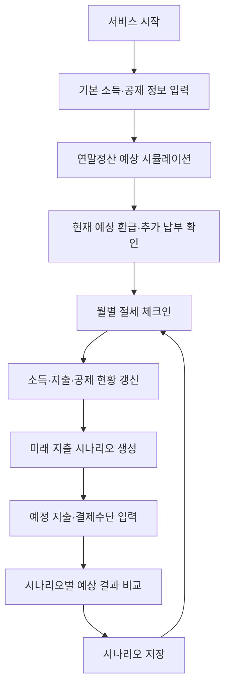
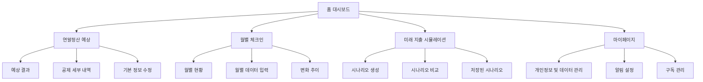

# PRD | AI 기반 연말정산 사전 관리 플랫폼

**문서 버전:** v0.1 (초안)  
**서비스 유형:** 개인 맞춤형 연말정산 예측·관리 서비스  
**서비스 대상:** 대한민국 근로소득자  
**핵심 기능:** 연말정산 예상 시뮬레이션 / 월별 절세 체크인 / 미래 지출 시나리오  
**서비스 방향:** 연말정산의 사후 확인을 사전 예측 및 지속적 관리 경험으로 전환

---

# 01. 제품 개요 (Product Overview)

## 1.1 서비스 콘셉트

> **"연말정산 결과를 기다리지 않고, 매월 확인하고 미리 대비하는 개인 맞춤형 절세 관리 서비스."**

기존 연말정산 서비스는 사용자가 연말 또는 연초에 세금 환급 여부를 확인하고 신고하는 데 집중되어 있다.

본 서비스는 사용자의 소득과 소비 데이터를 기반으로 연말정산 예상 결과를 제공하고, 남은 기간의 지출 계획에 따른 변화를 예측하여 사용자가 연중 자신의 세금 상황을 파악할 수 있도록 지원한다.

### 핵심 가치 제안

| 핵심 가치 | 기존 문제 | 해결 방향 |
|---|---|---|
| 예측 가능성 | 연말까지 예상 결과를 알기 어려움 | 현재 데이터 기반 예상 환급·추가 납부액 제공 |
| 지속적 관리 | 특정 시기에만 연말정산을 확인 | 월별 소비 및 공제 현황 체크인 |
| 계획 수립 | 미래 소비가 연말정산에 미치는 영향 파악 어려움 | 예정 지출에 따른 결과 비교 |

## 1.2 제품 목표

### 비즈니스 목표

1. 연말정산 서비스의 계절적 사용 패턴을 연중 이용 구조로 전환한다.
2. 사용자가 지속적으로 데이터를 입력하고 관리하도록 유도한다.
3. 기본 기능은 무료로 제공하고, 고급 시뮬레이션 및 리포트 기능을 통해 유료 전환을 유도한다.

### 사용자 목표

1. 현재 기준으로 연말정산 결과를 예측할 수 있다.
2. 매월 자신의 소비와 공제 현황을 확인할 수 있다.
3. 앞으로의 지출 계획이 예상 연말정산 결과에 미치는 영향을 비교할 수 있다.

## 1.3 핵심 타깃

**Primary Target: 25~39세 근로소득자**

- 연말정산 경험이 적은 사회초년생
- 연말정산 결과를 미리 예측하고 싶은 직장인
- 소비 계획을 세우지만 세금과의 관계를 파악하기 어려운 사용자
- 연중 자신의 소득과 지출을 체계적으로 관리하려는 직장인

**Secondary Target: 40~50대 근로소득자**

- 의료비·교육비 등 다양한 공제 항목을 관리해야 하는 사용자
- 가족 구성 및 공제 조건 변화가 있는 사용자

---

# 02. 문제 정의 (Problem Statement)

## 2.1 사용자 문제

### 문제 1. 연말정산 결과를 너무 늦게 확인한다.

**현재 상황**

사용자는 연말정산 시즌이 되어서야 예상 환급액이나 추가 납부액을 확인한다.

**문제점**

- 추가 납부가 발생할 경우 사전에 대비하기 어렵다.
- 연중 소비에 따른 세금 영향을 확인하기 어렵다.
- 과거 데이터를 확인하더라도 앞으로 어떻게 달라지는지 예측하기 어렵다.

**해결 방향**

현재까지의 소득과 공제 데이터를 기반으로 연말정산 예상 결과를 지속적으로 갱신한다.

### 문제 2. 공제 현황을 지속적으로 관리하기 어렵다.

**현재 상황**

사용자는 연말정산 관련 데이터를 매월 점검하기보다는 연말에 한꺼번에 확인하는 경향이 있다.

**문제점**

- 공제 대상 지출과 일반 소비를 구분하기 어렵다.
- 자신이 현재 어느 정도의 공제 요건을 충족했는지 파악하기 어렵다.
- 월별 소비 변화가 연말정산 결과에 어떻게 반영되는지 알기 어렵다.

**해결 방향**

월별 데이터를 시각화하고, 핵심 공제 항목의 충족 여부와 예상 결과 변화를 정기적으로 제공한다.

### 문제 3. 미래 소비 계획을 세금과 연결하기 어렵다.

**현재 상황**

사용자는 여행, 의료비, 교육비 등 예정된 지출에 대한 계획을 세우지만, 해당 지출이 연말정산에 미치는 영향을 사전에 비교하기 어렵다.

**문제점**

- 결제수단별 공제 반영 차이를 알기 어렵다.
- 지출 계획을 변경했을 때 결과를 비교하기 어렵다.
- 세금 혜택을 과대평가하거나 소비 자체가 절세라고 오해할 가능성이 있다.

**해결 방향**

예정 지출과 결제수단을 입력하면 실제 공제 적용 조건을 고려하여 예상 결과를 비교하는 시뮬레이션을 제공한다.

---

# 03. 핵심 사용자 경험 (Core User Experience)

## 3.1 전체 서비스 플로우

### 서비스 이용 구조

**최초 가입 시**

기본 정보 입력 → 연간 소득 추정 → 첫 연말정산 예상 결과 확인

**매월 이용 시**

월별 데이터 갱신 → 예상 결과 변화 확인 → 필요한 입력 항목 점검

**지출 계획 발생 시**

예정 지출 입력 → 시나리오 비교 → 소비 계획 참고

---

# 04. 핵심 기능 1 — 연말정산 예상 시뮬레이션

## 4.1 기능 정의

사용자의 현재 소득, 기납부세액, 공제 관련 정보를 기반으로 해당 과세연도의 연말정산 예상 환급액 또는 추가 납부액을 산출하는 기능.

**핵심 질문**

> "지금까지의 소득과 소비를 기준으로, 올해 연말정산 결과는 어떻게 예상될까?"

## 4.2 사용자 입력 데이터

| 데이터 유형 | 세부 항목 | 입력 방식 |
|---|---|---|
| 기본 정보 | 과세연도, 근로 기간 | 선택 |
| 소득 정보 | 총급여 또는 예상 연간 총급여 | 직접 입력 |
| 납부세액 | 현재까지 원천징수된 소득세 등 | 직접 입력 |
| 카드 지출 | 신용카드·체크카드·현금영수증 사용액 | 직접 입력 |
| 공제 관련 정보 | 보험료, 의료비, 교육비, 연금계좌 납입액 등 | 항목별 입력 |
| 인적공제 정보 | 부양가족 및 공제 요건 관련 정보 | 선택·입력 |

초기 MVP에서는 **사용자 직접 입력 방식**을 기본으로 한다. 카드사 및 금융기관 자동 연동 기능은 1차 개발 범위에서 제외한다.

## 4.3 주요 기능 요구사항

### FR-01. 기본 정보 수집

- 사용자는 연간 예상 총급여를 입력할 수 있어야 한다.
- 현재까지의 원천징수세액을 입력할 수 있어야 한다.
- 부양가족 및 주요 공제 관련 정보를 입력할 수 있어야 한다.
- 필수 입력 항목이 누락된 경우 사용자에게 안내해야 한다.
- 사용자는 입력한 정보를 수정할 수 있어야 한다.

### FR-02. 예상 결과 계산

시스템은 해당 과세연도에 적용되는 세법과 공제 요건을 기반으로 예상 결과를 산출한다.

**기본 계산 구조**

1. 예상 연간 총급여 산출
2. 적용 가능한 소득공제 추정
3. 과세표준 추정
4. 산출세액 계산
5. 적용 가능한 세액공제·감면 반영
6. 예상 결정세액 계산
7. 예상 연간 기납부세액과 비교
8. 예상 환급액 또는 추가 납부액 표시

예상 환급·추가 납부액은 연간 기납부세액과 예상 결정세액의 차이를 이용해 계산하되, 실제 적용되는 세금 항목과 원천징수 내역에 따라 계산 범위를 구분한다.

### FR-03. 결과 시각화

**메인 대시보드 제공 정보**

- 예상 환급액 또는 추가 납부액
- 지난 계산 대비 예상 결과 변화
- 반영된 주요 공제 항목
- 아직 입력하지 않은 항목
- 계산 기준 과세연도 및 업데이트 날짜

**표시 예시**

| 항목 | 예시 |
|---|---:|
| 예상 연간 총급여 | 4,000만 원 |
| 예상 결정세액 | 170만 원 |
| 예상 연간 기납부세액 | 200만 원 |
| 예상 환급액 | 30만 원 |

*위 금액은 화면 구성을 설명하기 위한 임의의 예시이며 실제 세법에 따른 계산 결과가 아니다.*

### FR-04. 예상 결과 신뢰도 표시

입력 데이터의 완성도에 따라 결과의 불확실성을 안내한다.

- **입력 부족:** 핵심 소득 또는 세액 데이터 누락
- **일부 추정:** 연간 소득이나 공제 데이터 중 일부 추정값 사용
- **입력 완료:** 계산에 필요한 필수 항목 입력 완료

입력 완료 상태여도 실제 환급액의 정확성을 보장하지 않으며, 공식 서류 확인 여부를 별도로 표시한다.

## 4.4 화면 구성

**Screen 01 — 연말정산 대시보드**

- 상단: 예상 환급·추가 납부액
- 중단: 연간 소득 및 주요 공제 현황
- 하단: 월별 예상 결과 추이
- CTA: '내 정보 수정하기', '지출 시뮬레이션'

**Screen 02 — 세부 계산 결과**

- 소득공제 요약
- 세액공제 요약
- 예상 결정세액
- 예상 기납부세액
- 계산 기준 및 추정 안내

## 4.5 완료 조건 (Acceptance Criteria)

- 필수 데이터를 입력하면 예상 결과가 출력된다.
- 입력값 수정 후 계산 결과가 갱신된다.
- 환급과 추가 납부가 시각적으로 구별된다.
- 계산에 적용된 기준 연도 및 주요 가정이 표시된다.
- 계산할 수 없는 상태에서 근거 없는 예상 금액을 출력하지 않는다.

---

# 05. 핵심 기능 2 — 월별 절세 체크인

## 5.1 기능 정의

사용자가 매월 자신의 소득과 소비 및 공제 현황을 갱신하고, 이전 달 대비 예상 연말정산 결과가 어떻게 변화했는지 확인하는 기능.

**핵심 질문**

> "이번 달 내 소비와 공제 현황은 어떻게 달라졌고, 연말정산에는 어떤 영향을 미쳤을까?"

## 5.2 주요 기능 요구사항

### FR-05. 월별 데이터 입력

사용자는 매월 다음 항목을 기록하거나 수정할 수 있어야 한다.

| 데이터 | 상세 내용 |
|---|---|
| 월별 소득 | 급여 및 원천징수 관련 정보 |
| 신용카드 사용액 | 해당 월 카드 사용액 |
| 체크카드 사용액 | 해당 월 체크카드 사용액 |
| 현금영수증 | 해당 월 발급 금액 |
| 주요 공제 항목 | 의료비, 교육비, 연금계좌 납입액 등 |
| 데이터 갱신 상태 | 입력 완료·미입력·수정 필요 |

## 5.3 월별 공제 현황 시각화

### FR-06. 공제 항목별 진행 현황

사용자가 주요 공제 항목의 현재 상태를 이해할 수 있도록 정보를 제공한다.

**예시: 카드 사용액 관련 현황**

- 현재까지 누적 사용액
- 사용자의 총급여 기준 관련 공제 적용 요건
- 현재 공제 반영 대상 추정 금액
- 카드 유형별 사용액

단, 신용카드 소득공제는 적용 요건, 결제수단, 공제 제외 지출, 한도 등에 따라 달라지므로 단순 총사용액만으로 공제액을 확정하지 않는다.

### FR-07. 월별 예상 결과 변화

사용자는 지난달과 이번 달의 예상 연말정산 결과를 비교할 수 있어야 한다.

**표시 예시**

| 항목 | 지난달 | 이번 달 |
|---|---:|---:|
| 예상 환급액 | 24만 원 | 30만 원 |
| 카드 누적 사용액 | 1,100만 원 | 1,250만 원 |
| 공제 데이터 | 4개 항목 입력 | 5개 항목 입력 |

변화가 발생한 원인은 소득, 공제 입력값 또는 추정 가정의 변경을 기준으로 구분해 제공한다.

### FR-08. 월별 체크인 알림

- 사용자는 매월 지정한 시점에 체크인 알림을 받을 수 있다.
- 미입력 항목이 있으면 알림에 표시할 수 있다.
- 체크인 완료 시 마지막 업데이트 날짜가 갱신된다.
- 사용자는 알림을 끄거나 빈도를 변경할 수 있다.

**알림 예시**

"10월 지출 정보를 입력할 시기예요. 이번 달 데이터를 반영해 예상 연말정산 결과를 확인해 보세요."

## 5.4 화면 구성

**Screen 03 — 월별 체크인 대시보드**

- 월 선택
- 이번 달 데이터 입력 상태
- 누적 소비 현황
- 공제 관련 진행 현황
- 지난달 대비 예상 결과 변화
- CTA: '이번 달 체크인'

**Screen 04 — 월별 정보 입력**

- 소득 및 원천징수 정보
- 결제수단별 지출
- 주요 공제 항목
- 입력값 저장
- 예상 결과 재계산

## 5.5 완료 조건

- 사용자는 원하는 월을 선택하고 데이터를 입력할 수 있다.
- 이전 달의 저장된 데이터를 확인할 수 있다.
- 중복 입력 또는 수정 시 누적 데이터가 올바르게 갱신된다.
- 데이터 변경 후 예상 연말정산 결과를 다시 계산한다.
- 월별 변화가 차트로 표시된다.
- 체크인 미완료와 실제 지출이 없는 상태를 구분한다.

---

# 06. 핵심 기능 3 — 미래 지출 시나리오

## 6.1 기능 정의

사용자가 앞으로 예정된 지출 금액, 지출 시점, 결제수단 등을 입력하면 해당 조건을 현재 연말정산 예상 결과에 반영하여 변화 가능성을 비교하는 기능.

**핵심 질문**

> "앞으로 예정된 소비를 반영하면, 올해 연말정산 결과는 얼마나 달라질까?"

세 가지 기능 중 사용자의 미래 의사결정을 지원하는 **핵심 차별화 기능**으로 설정한다.

## 6.2 사용자 시나리오

### 시나리오 A. 여행 지출 계획

사용자가 12월 여행을 위해 100만 원을 지출할 예정이다.

사용자는 지출 예정 시점과 결제수단을 선택하고, 해당 지출이 연말정산 예상 결과에 미치는 영향을 확인한다.

**주의:** 여행비 자체가 특별한 세액공제 대상이라는 의미는 아니다. 해당 지출이 관련 법령상 카드 소득공제 대상인지 등을 확인하여 반영한다.

### 시나리오 B. 의료비 지출 계획

사용자가 연말에 의료비 지출을 계획하고 있다.

예정 금액과 공제 관련 조건을 입력하면, 기존 지출과 합산해 예상 공제 반영 여부와 결과 변화를 확인할 수 있다.

### 시나리오 C. 결제수단 비교

사용자가 동일한 100만 원의 적격 소비를 신용카드 또는 체크카드로 결제하는 상황을 비교한다.

동일한 소비를 중복 반영하지 않고, 결제수단별 관련 공제 규칙을 적용해 결과를 비교한다.

## 6.3 주요 기능 요구사항

### FR-09. 미래 지출 등록

사용자는 다음 정보를 입력할 수 있어야 한다.

| 입력 항목 | 입력 예시 |
|---|---|
| 시나리오 이름 | 12월 여행 계획 |
| 예정 지출 금액 | 100만 원 |
| 예정 지출 시점 | 12월 |
| 지출 유형 | 일반 소비 / 의료비 / 교육비 등 |
| 결제수단 | 신용카드 / 체크카드 / 현금영수증 등 |
| 공제 관련 조건 | 필요시 추가 입력 |

### FR-10. 시나리오별 예상 결과 계산

시스템은 기존 연말정산 예상 결과를 기준선으로 저장하고, 미래 지출 조건을 적용한 별도의 결과를 계산한다.

**계산 구조**

1. 현재 기준 예상 연말정산 결과 확보
2. 예정 지출 정보 확인
3. 공제 대상 여부 및 관련 조건 판단
4. 해당 과세연도의 공제 계산 규칙 적용
5. 지출 반영 후 예상 결과 계산
6. 기존 결과와 시나리오 결과 비교

**예시**

| 비교 항목 | 현재 예상 | 시나리오 A |
|---|---:|---:|
| 예상 환급액 | 30만 원 | 34만 원 |
| 추가 예정 지출 | 없음 | 100만 원 |
| 예상 환급액 변화 | 기준 | +4만 원 |

*임의의 UI 예시이며, 100만 원 소비가 실제로 4만 원의 환급 증가를 발생시킨다는 의미는 아니다.*

### FR-11. 복수 시나리오 비교

사용자는 서로 다른 지출 계획을 저장하고 비교할 수 있어야 한다.

**예시**

| 구분 | 기본 시나리오 | 시나리오 A | 시나리오 B |
|---|---|---|---|
| 지출 금액 | 0원 | 100만 원 | 100만 원 |
| 결제수단 | - | 신용카드 | 체크카드 |
| 공제 반영 | 현재 기준 | 조건 충족 시 | 조건 충족 시 |
| 예상 결과 | 기준 | 재계산 | 재계산 |

동일한 예정 지출은 서로 대안 관계로 설정할 수 있어야 하며, 중복 합산되지 않아야 한다.

### FR-12. 시나리오 저장 및 수정

- 사용자는 시나리오 이름을 지정할 수 있다.
- 생성한 시나리오를 저장·수정·삭제할 수 있다.
- 실제 지출이 발생했을 경우 월별 체크인 데이터에 반영할 수 있다.
- 실제 반영 시 같은 지출을 이중 계산하지 않는다.
- 과세연도 변경 시 이전 시나리오의 계산 기준을 보존하거나 재계산 여부를 안내한다.

## 6.4 화면 구성

**Screen 05 — 미래 지출 시뮬레이션**

- 현재 예상 환급·추가 납부액
- 지출 시나리오 입력 카드
- 결제수단 선택
- 예상 결과 변화 시각화
- CTA: '결과 비교하기'

**Screen 06 — 시나리오 비교**

- 현재 기준 결과
- 시나리오 A 결과
- 시나리오 B 결과
- 예상 결과 차이
- 결과 변화 요인
- CTA: '시나리오 저장'

## 6.5 필수 UX 원칙

**1. 소비를 절세 행동으로 오인시키지 않는다.**

추가 소비에 따른 환급액 변화만 강조하지 않고, 실제 지출 금액과 예상 세금 차이를 함께 표시한다.

**2. 세금 환급액과 경제적 이익을 구분한다.**

예상 환급액 증가가 전체 소비의 경제적 이익을 의미하지 않는다는 점을 명확히 한다.

**3. 정확하지 않은 결과를 확정적으로 안내하지 않는다.**

소득 또는 공제 관련 정보가 부족한 경우 가정 기반 결과임을 표시한다.

## 6.6 완료 조건

- 사용자는 미래 지출 시나리오를 생성할 수 있다.
- 최소 2개 시나리오를 비교할 수 있다.
- 지출·결제수단 변경 시 예상 결과가 다시 계산된다.
- 공제 적용이 불가능하거나 불확실한 경우 그 사유가 표시된다.
- 시나리오가 실제 월별 데이터와 중복 계산되지 않는다.
- 시나리오 저장·수정·삭제가 가능하다.

---

# 07. 정보 구조 (Information Architecture)

## 홈 대시보드 권장 구성

**상단**

- 해당 과세연도
- 현재 예상 환급액 또는 추가 납부액
- 최근 계산 업데이트 날짜

**중단**

- 월별 체크인 현황
- 주요 공제 항목 요약
- 지난달 대비 예상 결과 변화

**하단**

- 미래 지출 시뮬레이션 바로가기
- 최근 저장된 시나리오
- 정보 입력 및 갱신 안내

---

# 08. 기능 우선순위 (MVP Scope)

| 우선순위 | 기능 | 단계 |
|---|---|---|
| P0 | 기본 소득·공제 정보 입력 | MVP 필수 |
| P0 | 연말정산 예상 결과 계산 | MVP 필수 |
| P0 | 월별 지출·공제 데이터 입력 | MVP 필수 |
| P0 | 월별 예상 결과 갱신 | MVP 필수 |
| P0 | 미래 지출 시나리오 생성 | MVP 필수 |
| P0 | 시나리오별 결과 비교 | MVP 필수 |
| P1 | 시나리오 저장 및 수정 | MVP 확장 |
| P1 | 월별 체크인 알림 | MVP 확장 |
| P1 | 연간 추이 리포트 | MVP 확장 |
| P2 | 금융기관 데이터 연동 | 후속 검토 |
| P2 | 고급 개인화 분석 | 후속 검토 |

### 이번 PRD에서 제외하는 기능

- 정부 지원금 및 정책 혜택 추천
- 해외 시장 진출 및 해외 세법 지원
- 세금 용어 사전 및 쉬운 세금 설명 기능
- 세무 신고서 작성 및 신고 대행
- 금융상품 가입 중개
- 자동 은행·카드 계좌 연동(MVP 기준)

---

# 09. 데이터 및 기술 요구사항

## 9.1 핵심 데이터 구조

| 데이터 객체 | 주요 필드 |
|---|---|
| User | 사용자 ID, 과세연도, 기본 정보 |
| Income | 급여, 근로 기간, 원천징수세액 |
| Deduction | 공제 유형, 금액, 적용 조건 |
| MonthlyRecord | 연월, 소득, 지출, 입력 상태 |
| TaxEstimate | 예상 결정세액, 기납부세액, 예상 결과, 계산 버전 |
| SpendingScenario | 시나리오 ID, 금액, 날짜, 유형, 결제수단 |
| ScenarioResult | 기준 예상 결과, 변경 예상 결과, 차이 |

## 9.2 계산 엔진 요구사항

- 과세연도별 세율 및 공제 규칙을 분리 관리한다.
- 소득·세액공제 한도 및 적용 요건을 반영한다.
- 입력값이 변경되면 관련 예상 결과를 재계산한다.
- 계산 결과와 함께 적용된 규칙 버전을 저장한다.
- 연말 예상 소득과 실제 발생 소득을 구분한다.
- 확인되지 않은 정보를 임의의 확정값으로 처리하지 않는다.

## 9.3 개인정보 및 법적 요구사항

- 사용자의 소득·소비 정보는 최소한으로 수집한다.
- 정보 수집·보관·삭제에 관한 동의 및 안내를 제공한다.
- 금융정보 전송 및 저장 과정에서 적절한 보호조치를 적용한다.
- 예측 결과는 실제 연말정산 확정 금액과 차이가 발생할 수 있음을 안내한다.
- 세무 상담·자문과 일반 계산 도구의 경계를 출시 전 법률 검토한다.

---

# 10. 수익 모델

핵심 기능의 사용성을 검증한 뒤 프리미엄 기능을 중심으로 수익화를 진행한다.

| 구분 | 무료 | 프리미엄 |
|---|---|---|
| 기본 연말정산 예상 결과 | 제공 | 제공 |
| 월별 데이터 입력 | 제공 | 제공 |
| 기본 월별 변화 확인 | 제공 | 제공 |
| 미래 지출 시나리오 | 기본 비교 | 다중 시나리오 관리 |
| 시나리오 저장 | 제한적 | 확장 제공 |
| 상세 연간 분석 | 제한적 | 제공 |
| 고급 리포트 | 미제공 | 제공 |

**가격 가정:** 연 19,900~29,900원

수익화는 필수적인 세무정보 제공 자체를 유료로 제한하기보다, 반복 관리와 시뮬레이션의 편의 기능을 고도화하는 방향으로 설계한다.

---

# 11. 성공 지표 (Success Metrics)

| KPI | 정의 | 검증 목적 |
|---|---|---|
| 첫 계산 완료율 | 가입자 중 첫 연말정산 계산 완료 비율 | 온보딩 |
| 월별 체크인율 | 해당 월 활성 사용자 중 체크인 완료 비율 | 지속 이용 |
| 3개월 유지율 | 가입 후 3개월 차에도 이용하는 사용자 비율 | 제품 유지력 |
| 시나리오 생성률 | 활성 사용자 중 시나리오를 생성한 비율 | 차별화 기능 수요 |
| 시나리오 재사용률 | 기존 시나리오를 다시 확인하거나 수정한 비율 | 기능 효용 |
| 유료 전환율 | 무료 사용자 중 유료 구독으로 전환한 비율 | 수익성 |

**가장 중요한 핵심 지표: 월별 체크인 유지율**

이 서비스가 연말정산 시즌에만 이용되는 문제를 해결했는지 판단하는 핵심 지표다.

---

# 12. 검증해야 할 핵심 가설

| 가설 | 검증 방법 | 판단 기준 |
|---|---|---|
| H1. 사용자는 연말정산 예상액을 연중 확인하고 싶어 한다. | 인터뷰·프로토타입 테스트 | 반복 조회 의향 및 실제 조회 행동 |
| H2. 월별 체크인이 재방문율을 높인다. | 체크인 기능 사용자 실험 | 월별 이용 및 3개월 유지율 |
| H3. 미래 지출 시뮬레이션은 사용자의 소비 계획 수립에 도움이 된다. | 과업 기반 사용성 테스트 | 결과 이해도와 계획 변경 의사 |
| H4. 사용자는 고급 시나리오 관리 기능에 비용을 지불할 의향이 있다. | 가격 테스트·유료 전환 실험 | 실제 결제 전환율 |

---

# 13. 개발 전 확인 사항 (Open Questions)

1. 초기 사용자 데이터는 모두 수동 입력으로 시작할 것인가?
2. 정확한 예상 결과를 위해 필수로 받아야 하는 최소 정보는 무엇인가?
3. 연말 예상 급여와 기납부세액은 어떤 기준으로 추정할 것인가?
4. 월별 체크인은 얼마나 간단해야 사용자가 꾸준히 참여할 수 있는가?
5. 미래 지출 시나리오는 몇 개까지 무료로 제공할 것인가?
6. 계산 결과의 신뢰도와 불확실성을 어떤 UI로 표현할 것인가?
7. 세무사법상 일반 계산 도구와 개인별 세무 자문의 경계를 어떻게 검증할 것인가?

---

# 14. 최종 제품 정의

**본 서비스는 사용자가 연말정산 결과를 미리 예측하고, 월별 소비 및 공제 현황을 지속적으로 점검하며, 미래 지출 계획에 따른 예상 결과를 비교할 수 있도록 지원하는 연중 절세 관리 플랫폼이다.**

### 핵심 제품 구조

**예측 (Predict)**  
연말정산 예상 시뮬레이션

↓

**관리 (Track)**  
월별 절세 체크인

↓

**계획 (Plan)**  
미래 지출 시나리오

↓

**재예측 (Recalculate)**  
변경된 정보를 반영한 연말정산 예상 결과 갱신

**최종 UX 목표:** 사용자가 연말정산 시즌에만 세금을 확인하는 것이 아니라, 자신의 금융생활을 연중 이해하고 계획할 수 있도록 돕는다.
